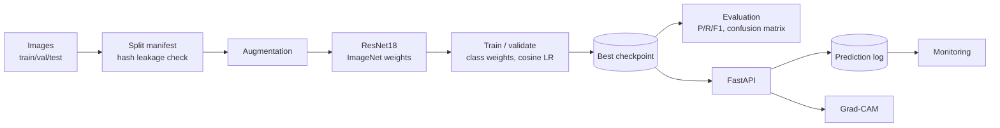

# DefectIQ — Industrial Visual Defect Detection

An end-to-end deep-learning inspection system: a ResNet18 classifier flags
defective product images, explains the decision with Grad-CAM, serves predictions
behind FastAPI, and records every inspection for monitoring.

Built as a Deep Learning + Computer Vision + PyTorch + model-deployment project —
not a notebook demo.

```
Product image → validation → resize / normalise → ResNet18 (transfer learning)
   → normal | defective + defect type + confidence
   → Grad-CAM heatmap → FastAPI → SQLite/Postgres log → Streamlit dashboard
```


## Results on the held-out test split (70 images)

| Metric | Value |
| --- | --- |
| Binary accuracy (normal vs defective) | **0.986** |
| Precision | **1.000** |
| Recall | **0.982** |
| F1 | **0.991** |
| ROC AUC | **0.996** |
| 5-way accuracy (defect type) | **0.971** |
| Macro F1 | **0.971** |
| Mean forward latency (CPU, batch 1) | **21.8 ms** |
| Training time (8 epochs, CPU) | **100 s** |

One defective unit was missed out of 56 (the expensive error on a line) and the
only defect-type confusions were scratch ↔ crack. Full tables, confusion matrix
and caveats: [docs/results.md](docs/results.md).

## Features (8/8)

| # | Feature | Implementation |
| --- | --- | --- |
| 1 | Dataset management | ImageFolder discovery, class counts, split manifest with SHA-256 leakage checks, preview grid (`data/`) |
| 2 | Preprocessing & augmentation | Resize, RGB, ImageNet normalisation, crop/flip/rotation/colour jitter, upload validation (`preprocessing/`) |
| 3 | ResNet18 transfer learning | Pretrained backbone, frozen first epoch, class-weighted loss, AdamW + cosine schedule, early stopping (`modeling/`) |
| 4 | Defect prediction | Single and batch inference, normal/defective decision, defect type, confidence, latency (`inference/predictor.py`) |
| 5 | Evaluation | Accuracy, precision, recall, F1, ROC AUC, confusion matrix, per-class table, loss/accuracy curves, model card (`modeling/evaluate.py`) |
| 6 | Grad-CAM | Layer-4 hooks, JET heatmap, blended overlay, PNG endpoint (`explain/gradcam.py`) |
| 7 | FastAPI deployment | `/health`, `/predict`, `/predict/batch`, `/model-info`, `/predictions` (`api/`) |
| 8 | Monitoring & optimisation | Counts, defect mix, latency p95, failures, model versions, batch benchmark, CPU/GPU switch, Docker (`db/`, `scripts/benchmark.py`) |

Bonus: Streamlit dashboard (inspect, model performance, monitoring, dataset),
52 offline tests, GitHub Actions, Docker Compose.

## Dataset

The repo ships a deterministic synthetic surface-defect corpus: 320 images,
5 classes (`good`, `scratch`, `dent`, `crack`, `stain`), split 200 / 50 / 70.


Why synthetic: MVTec AD is an *anomaly-detection* benchmark (training split has
only good images) and NEU-DET is gated, so neither can train a supervised
classifier out of the box. The generator makes the project reproducible offline,
and the loader accepts any real ImageFolder dataset — see
[data/README.md](data/README.md).

## Quickstart

```bash
git clone https://github.com/deepaktripathii/Product-Defect-Detection.git
cd Product-Defect-Detection

python -m venv .venv
# Windows: .venv\Scripts\activate
source .venv/bin/activate

pip install -r requirements.txt
pip install -e .

python scripts/generate_demo_dataset.py   # 320 images, ~4 MB
python scripts/train.py                   # ~2 minutes on CPU
```

Run the API:

```bash
uvicorn defectiq.api.main:app --reload
# http://localhost:8000/docs
```

Run the dashboard in a second terminal:

```bash
streamlit run src/defectiq/dashboard/app.py
# http://localhost:8501
```

Populate the monitoring page with demo traffic:

```bash
python scripts/simulate_inspections.py --n 60
```

## Inspect an image

```bash
curl -X POST "http://localhost:8000/predict?explain=true" \
  -F "file=@data/demo_dataset/test/scratch/scratch_000.jpg"
```

```json
{
  "prediction": "defective",
  "defect_type": "scratch",
  "confidence": 0.9338,
  "defective_probability": 0.9972,
  "probabilities": {
    "crack": 0.0592, "dent": 0.0023, "good": 0.0028,
    "scratch": 0.9338, "stain": 0.0020
  },
  "model_version": "resnet18-2026.09.18-104233",
  "device": "cpu",
  "latency_ms": 37.7,
  "heatmap_png_base64": "iVBORw0KGgo..."
}
```

Full reference: [docs/api.md](docs/api.md).

## API surface

| Method | Path | Purpose |
| --- | --- | --- |
| GET | `/health` | Model, device, database and volume status |
| POST | `/predict` | One image, optional Grad-CAM overlay |
| POST | `/predict/batch` | Up to 16 images in one forward pass |
| GET | `/model-info` | Architecture, classes, threshold, metrics |
| GET | `/predictions` | Inspection history with filters |
| GET | `/monitoring/summary` | Counts, defect mix, latency, failures |
| GET | `/evaluation/latest` | Last test-set report |
| POST | `/evaluation/run` | Re-run evaluation on val/test |

## Architecture



Design decisions and failure modes: [docs/architecture.md](docs/architecture.md).

## Project structure

```
src/defectiq/
├── config.py               # env-driven paths, image size, threshold, device
├── data/                   # discovery, split manifest, class analysis
├── preprocessing/          # train/eval transforms, image validation
├── modeling/               # ResNet18, trainer, metrics, model card
├── explain/gradcam.py      # Grad-CAM heatmap and overlay
├── inference/predictor.py  # single/batch inference and explanations
├── db/                     # prediction log and monitoring aggregates
├── api/                    # FastAPI app and schemas
└── dashboard/              # Streamlit UI
scripts/                    # generate, train, evaluate, predict, benchmark, simulate
tests/                      # 52 offline tests
docs/                       # architecture, API, results, dataset, interview notes
data/demo_dataset/          # 320 committed images + splits.json
```

## Testing & CI

```bash
pip install -r requirements-dev.txt
pytest -q          # 52 tests, offline, ~11 s
ruff check src tests scripts
```

Tests draw their own tiny 64×64 dataset, train a one-epoch model without
pretrained weights, and cover dataset discovery and leakage checks, transforms,
checkpoint round trip, training, metrics, Grad-CAM, prediction, the prediction
log and every API endpoint.

CI installs CPU PyTorch, runs lint and tests, then smoke-trains on the demo
dataset.

## Docker

```bash
docker compose up --build
# API       → http://localhost:8000/docs
# Dashboard → http://localhost:8501
```

The image installs CPU PyTorch and bakes the ImageNet weights; the entrypoint
trains a baseline checkpoint on first boot if `artifacts/models/` is empty.
GPU, scaling and threshold guidance: [docs/deployment.md](docs/deployment.md).

## Optimisation notes

| Change | Effect |
| --- | --- |
| Batch 1 → 8 | 21.8 → 15.4 ms/image (~40% more throughput on CPU) |
| Eval transform | Resize 256 + centre crop 224, no augmentation |
| Frozen first epoch | Protects ImageNet filters, faster convergence on 200 images |
| `torch.no_grad` inference | No graph allocation, lower memory and latency |
| GPU when available | `DEFECTIQ_DEVICE=cuda`; batch 8 measured locally on CPU only |

## Technology

| Technology | Role |
| --- | --- |
| Python 3.10+ | Core |
| PyTorch + Torchvision | ResNet18, transforms, training |
| OpenCV | Heatmap colouring and overlay |
| Pillow + NumPy | Image decoding, array work |
| Scikit-learn | Metrics, confusion matrix |
| FastAPI + Pydantic | REST API |
| SQLAlchemy + SQLite/PostgreSQL | Inspection log |
| Streamlit | Dashboard |
| Docker + Compose, GitHub Actions | Packaging and CI |

## Limitations

- Synthetic corpus; fine-tune on the operator's camera, lighting and product
  variants before production.
- 70 test images is small — one error shifts recall by ~1.8 points.
- Softmax scores are not calibrated; set the 0.5 threshold from the cost of a
  missed defect versus a re-inspection.
- Grad-CAM shows influence, not a verified defect mask.
- Monitoring covers volume, latency and failures; accuracy drift needs
  human-verified outcomes joined to prediction rows.

## Documentation

- [Architecture](docs/architecture.md)
- [API reference](docs/api.md)
- [Results](docs/results.md)
- [Dataset](data/README.md)
- [Deployment](docs/deployment.md)
- [Interview notes](docs/interview-notes.md)

## Licence

MIT — see [LICENSE](LICENSE). The demo images are synthetic and generated by the
repository itself.
