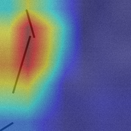
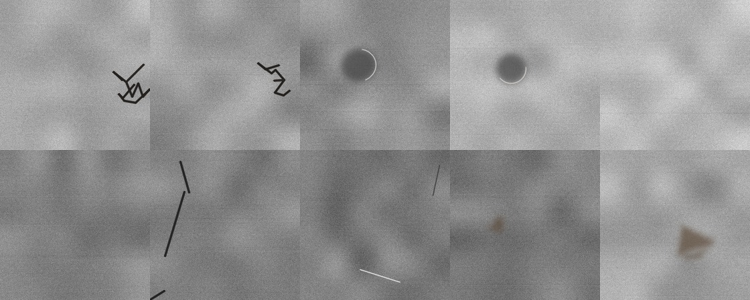

# Industrial Visual Defect Detection

ResNet18 image classifier that flags defective products, predicts the defect
type, explains the decision with Grad-CAM and serves predictions through FastAPI.

```
Image -> validation -> resize/normalise -> ResNet18 -> normal | defective + type
  -> Grad-CAM overlay -> FastAPI -> inspection log -> dashboard
```



## Results

Held-out test split, 70 images, 224x224, 8 epochs on CPU:

| Metric | Value |
| --- | --- |
| Binary accuracy | 0.986 |
| Precision | 1.000 |
| Recall | 0.982 |
| F1 | 0.991 |
| ROC AUC | 0.996 |
| 5-way accuracy | 0.971 |
| Macro F1 | 0.971 |
| Latency (batch 1, CPU) | 21.8 ms |
| Training time | 100 s |

One defective unit was missed out of 56; the only defect-type confusions were
scratch <-> crack. Details: [docs/results.md](docs/results.md).

## Dataset

320 synthetic surface images in 5 classes (`good`, `scratch`, `dent`, `crack`,
`stain`), split 200 / 50 / 70. Every image is hashed in `splits.json`, and the
trainer reports any duplicate that appears in more than one split.



The loader accepts any ImageFolder dataset with `train/`, `val/`, `test/` and a
`good` class. MVTec AD is anomaly detection (no defective training images), so
it cannot train this supervised classifier without synthetic defects. See
[data/README.md](data/README.md).

## Features

1. Dataset management: discovery, class counts, split manifest and leakage
   checks.
2. Preprocessing: RGB conversion, resize/crop, ImageNet normalisation and
   crop/flip/rotation/colour-jitter augmentation.
3. Model: ResNet18 with ImageNet weights, frozen first epoch, class-weighted
   loss, AdamW, cosine schedule and early stopping.
4. Prediction: single and batch inference, normal/defective decision, defect
   type, confidence and latency.
5. Evaluation: accuracy, precision, recall, F1, ROC AUC, confusion matrix,
   per-class table, loss/accuracy curves and a model card.
6. Grad-CAM: layer-4 heatmap blended over the input image.
7. FastAPI: `/health`, `/predict`, `/predict/batch`, `/model-info`,
   `/predictions`.
8. Monitoring: counts, defect mix, p95 latency, failures, model versions; batch
   benchmark for CPU/GPU sizing.

## Quickstart

```bash
python -m venv .venv
# Windows: .venv\Scripts\activate
source .venv/bin/activate

pip install -r requirements.txt
pip install -e .

python scripts/generate_demo_dataset.py
python scripts/train.py
uvicorn defect_detection.api.main:app --reload
```

Dashboard:

```bash
streamlit run src/defect_detection/dashboard/app.py
```

Demo traffic:

```bash
python scripts/simulate_inspections.py --n 60
```

## API

| Method | Path | Purpose |
| --- | --- | --- |
| GET | `/health` | Model, device and database status |
| POST | `/predict` | Inspect one image (`?explain=true` adds Grad-CAM) |
| POST | `/predict/batch` | Up to 16 images in one forward pass |
| GET | `/model-info` | Architecture, classes, threshold, metrics |
| GET | `/predictions` | Inspection history |
| GET | `/monitoring/summary` | Volume, defect mix, latency, failures |
| GET | `/evaluation/latest` | Last test-set report |

```bash
curl -X POST "http://localhost:8000/predict?explain=true" \
  -F "file=@data/demo_dataset/test/scratch/scratch_000.jpg"
```

```json
{
  "prediction": "defective",
  "defect_type": "scratch",
  "confidence": 0.9338,
  "defective_probability": 0.9972,
  "model_version": "resnet18-2026.09.18-104233",
  "latency_ms": 37.7,
  "heatmap_png_base64": "iVBORw0KGgo..."
}
```

## Project structure

```
src/defect_detection/
  config.py
  data/            discovery, split manifest, analysis
  preprocessing/   transforms and image validation
  modeling/        ResNet18, trainer, metrics, model card
  explain/         Grad-CAM
  inference/       predictor
  db/              inspection log and monitoring
  api/             FastAPI app and schemas
  dashboard/       Streamlit UI
scripts/           generate, train, evaluate, predict, benchmark, simulate
tests/             52 offline tests
docs/              architecture, API, results, deployment, interview notes
data/demo_dataset/ 320 images + splits.json
```

## Tests

```bash
pip install -r requirements-dev.txt
pytest -q
ruff check src tests scripts
```

Tests draw a tiny 64x64 dataset, train one epoch without pretrained weights and
cover data, transforms, training, metrics, Grad-CAM, prediction, logging and the
API.

## Docker

```bash
docker compose up --build
# API       -> http://localhost:8000
# Dashboard -> http://localhost:8501
```

The image installs CPU PyTorch, bakes the ImageNet weights and trains a baseline
checkpoint on first boot if none exists.
