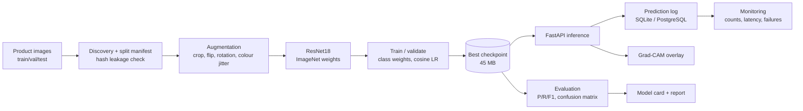

# Architecture



## Training pipeline

```
scripts/generate_demo_dataset.py      # or a real ImageFolder dataset
        |
        v
discover_dataset()  -> class list, counts, layout validation
verify_manifest()   -> SHA-256 duplicates across splits?
        |
        v
build_train_transform() / build_eval_transform()
RandomResizedCrop(224)               Resize(256) -> CenterCrop(224)
RandomHorizontalFlip / Rotation(8)   ToTensor + ImageNet normalisation
ColorJitter
        |
        v
ResNet18(weights=IMAGENET1K_V1) -> Dropout(0.2) -> Linear(512, C)
AdamW(lr=1e-4, wd=1e-4) + CosineAnnealingLR + CrossEntropy(weight=class_weights)
        |
        v
epoch loop: train -> validate (macro F1) -> checkpoint if improved -> early stop
        |
        v
artifacts/models/resnet18_defect.pt
artifacts/reports/history.json
```

## Inference pipeline

```
POST /predict (multipart)
  -> size / format validation (PIL decode, RGB conversion)
  -> eval transform (resize, centre crop, normalise)
  -> forward pass (batch of 1)
  -> softmax -> P(good) -> defective = 1 - P(good)
  -> threshold -> normal | defective + defect type + confidence
  -> optional Grad-CAM: hooks on layer4[-1] -> heatmap -> JET overlay PNG
  -> persist record (latency, device, model version)
```

## Module map

| Path | Responsibility |
| --- | --- |
| `src/defect_detection/config.py` | Paths, image size, training and threshold settings |
| `src/defect_detection/data/dataset.py` | Discovery, ImageFolder loaders, class weights |
| `src/defect_detection/data/splits.py` | Hashing, split manifest, leakage verification |
| `src/defect_detection/data/analysis.py` | Class distribution, balance, image stats, preview grid |
| `src/defect_detection/preprocessing/transforms.py` | Train/eval transforms, validation, RGB, denormalise |
| `src/defect_detection/modeling/model.py` | ResNet18 builder, checkpoint save/load, versioning |
| `src/defect_detection/modeling/trainer.py` | Epoch loop, freeze/unfreeze, early stopping, history |
| `src/defect_detection/modeling/evaluate.py` | Binary + multiclass metrics, test report, model card |
| `src/defect_detection/explain/gradcam.py` | Grad-CAM hooks, heatmap, overlay PNG |
| `src/defect_detection/inference/predictor.py` | Single/batch prediction, explanations, metadata |
| `src/defect_detection/db/` | Prediction records and monitoring aggregates |
| `src/defect_detection/api/` | FastAPI routes and schemas |
| `src/defect_detection/dashboard/` | Streamlit UI (inspect, model, monitoring, dataset) |
| `scripts/` | Dataset generation, train, evaluate, predict, benchmark, simulation |
| `tests/` | 52 offline tests with a tiny Pillow-drawn dataset |

## Key design decisions

1. **Transfer learning before architecture surgery.** ImageNet pretrained
   ResNet18 with a fresh head converges on 200 images in one minute on CPU.
   Freezing the backbone for the first epoch protects the pretrained filters.
2. **Two decision outputs from one head.** The model predicts five classes; the
   binary normal/defective decision is derived as `1 - P(good)`. This gives the
   operator the defect type for triage while keeping a single calibrated
   threshold for accept/reject.
3. **Page-level provenance is replaced by source provenance.** Every stored
   prediction keeps the file hash, model version, device and latency so a
   disputed decision can be reproduced.
4. **Splits are provable, not assumed.** The manifest hashes every image before
   training; duplicated images across train/test are reported as leakage.
5. **Failures are data.** Invalid uploads and inference crashes are written to
   the prediction log with `status=failed`, so the failure rate is visible in
   monitoring instead of disappearing into server logs.
6. **Grad-CAM is an explanation, not a segmentation mask.** The heatmap shows
   which regions influenced the class score at the last convolutional layer; it
   is intentionally coarse and must not be presented as a verified defect mask.
7. **CPU-first, GPU-ready.** `resolve_device` selects CUDA/MPS when available;
   the benchmark script measures batch throughput so operators can size a GPU
   only when the line speed requires it.

## Failure modes

| Failure | Behaviour |
| --- | --- |
| No checkpoint | API starts; `/health` reports `degraded`; `/predict` returns 503 |
| Corrupt upload | 400 with reason; logged as a failed inspection |
| Oversized upload | 413 before the file is read into the model |
| Split leakage | Training prints a warning with the offending paths |
| Missing class folder | Discovery raises with the exact split and class |
| GPU unavailable | Falls back to CPU and reports it in `/health` |
| Batch too large | Endpoint caps at 16 images per request |
| Model confidence misleading | Risk disclaimer in API docs, README and dashboard |

## Extension points

- Replace ResNet18 with EfficientNet/MobileNet for edge deployment.
- Add an unsupervised anomaly branch (PatchCore) for MVTec-style data.
- Store crops/heatmaps in object storage for audit.
- Collect human-verified outcomes and join them to prediction rows for real
  drift and accuracy monitoring.
