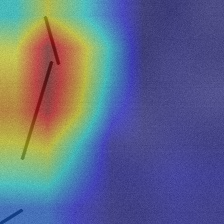

# Results

Measured on the 70-image held-out test split (14 images per class), ResNet18
with ImageNet weights, 224 × 224 input, 8 epochs (1 frozen backbone epoch),
batch 32, CPU-only training.

## Training

| Item | Value |
| --- | --- |
| Train / val / test images | 200 / 50 / 70 |
| Epochs | 8 (best epoch 7) |
| Optimiser | AdamW, lr 1e-4, weight decay 1e-4 |
| Schedule | Cosine annealing, class-weighted cross-entropy |
| Training time | **100 s on CPU** (≈13 s/epoch) |
| Best validation macro F1 | 1.000 |
| Checkpoint size | 42.7 MB |

Validation saturates quickly because the synthetic defects are visually
distinct; real production data will need more epochs and more images.

## Binary defect detection (normal vs defective)

| Metric | Value |
| --- | --- |
| Accuracy | **0.9857** |
| Precision | **1.0000** |
| Recall | **0.9821** |
| F1 | **0.9910** |
| ROC AUC | **0.9962** |
| Threshold | 0.50 |

Confusion matrix (test = 70 images):

| | Predicted normal | Predicted defective |
| --- | --- | --- |
| **Actual normal** | 14 (TN) | 0 (FP) |
| **Actual defective** | 1 (FN) | 55 (TP) |

Only one defective unit was missed. That is the error that matters on an
inspection line: a false negative ships a bad part, a false positive costs a
manual re-check.

## Per-class performance (5-way)

| Class | Precision | Recall | F1 | Support |
| --- | --- | --- | --- | --- |
| crack | 1.000 | 0.929 | 0.963 | 14 |
| dent | 1.000 | 1.000 | 1.000 | 14 |
| good | 0.933 | 1.000 | 0.966 | 14 |
| scratch | 0.929 | 0.929 | 0.929 | 14 |
| stain | 1.000 | 1.000 | 1.000 | 14 |

Macro F1 0.9714 · weighted F1 0.9714 · 5-way accuracy 0.9714.

Confusion matrix (rows = actual, columns = predicted, order crack, dent, good,
scratch, stain):

```
[[13,  0,  0,  1,  0],
 [ 0, 14,  0,  0,  0],
 [ 0,  0, 14,  0,  0],
 [ 0,  0,  1, 13,  0],
 [ 0,  0,  0,  0, 14]]
```

The two mistakes are the expected pair: one scratch classified as a crack, and
one crack classified as scratch. Their geometry is similar; the binary decision
is still correct in both cases, which is why the accept/reject metric is higher
than the defect-type metric.

## Latency (CPU, 224 × 224)

| Batch | Batch latency | Per image | Throughput |
| --- | --- | --- | --- |
| 1 | 21.8 ms | 21.8 ms | 45.9 img/s |
| 4 | 67.4 ms | 16.8 ms | 59.4 img/s |
| 8 | 123.2 ms | 15.4 ms | 65.0 img/s |

End-to-end single image (decode + transform + forward): **23.1 ms**.
Report: `artifacts/reports/benchmark.json` (`python scripts/benchmark.py`).

Batching improves throughput by ~40% even on CPU because fixed per-batch
overheads are amortised. On a production line shooting 10–20 parts per second,
one GPU with batch 8 is comfortably enough.

## Grad-CAM



The heatmap for a scratch image concentrates on the scratch and fades out over
the clean surface, which is the behaviour an inspector expects from an
explanation. It is a coarse last-layer attribution, not a segmentation mask.

## Honest caveats

- These numbers are on a synthetic corpus. They prove the pipeline and the
  evaluation harness, not real-world robustness.
- 70 test images is small: one error moves recall by 1.8 points. Grow the test
  set before reading fine differences between models.
- Softmax confidence is not calibrated. The 0.5 defective threshold should be
  set from the cost ratio of a missed defect vs a false alarm, using the ROC
  curve on validation data.
- Lighting, camera and product-variant changes will shift the input
  distribution. There is no drift detector yet; monitoring currently tracks
  volumes, latency and failure rates.
